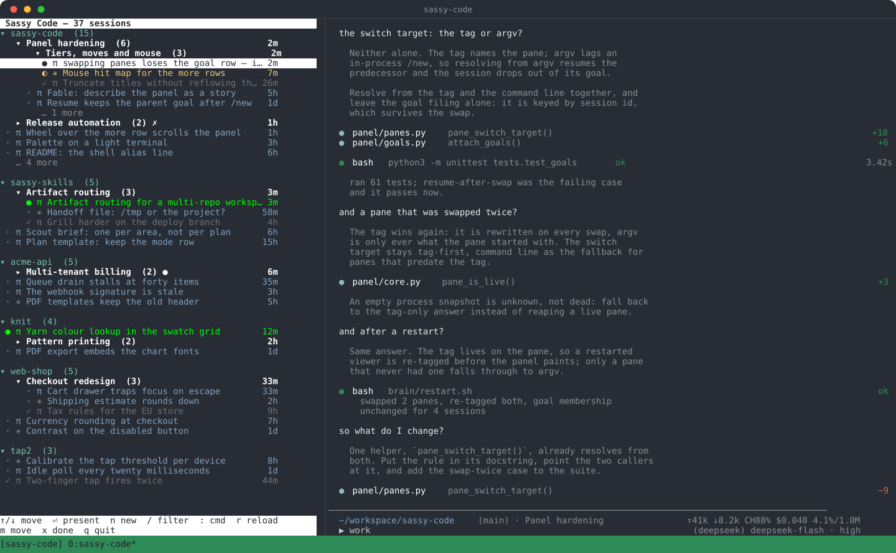

# Sassy Code

**A lean, fast tmux control panel for Pi and Claude Code sessions — switch sessions without losing work.**

Sassy Code gives you a two-pane cockpit: a fast session list on the left and the
live agent session on the right. Switching keeps in-flight work alive in
background tmux panes. Sessions from both harnesses share one list, grouped by
working directory and marked with a small glyph: `π` for Pi, `✳` for Claude Code.



*Drawn from a demo store by `.agents/skills/sassy-code-shot/`: six projects,
both harnesses, every status mark. It renders a fixture, never your own
sessions, and is refreshed whenever a release is cut, so it shows the panel as
the tagged version looks.*

Titles truncate to one line with an ellipsis; the age is right-aligned. Projects
are labelled with the folder's own name — `root` for home, `tap2-workspace`
rather than the whole path — with a blank line between them. A project shows its
five most recent items (a goal counts as one) plus `… N more`; each reveal
doubles the increment (+10, +20, +40), lifting the cap 5, 15, 35, 75, then all.
`]` expands a collapsed container at the base tier and otherwise reveals one
tier; `[` hides one tier and then collapses. Activating `… N more` reveals and
`… show fewer` hides one, skipping tiers whose cap adds no row. Goals tier from
3 children (sessions and slices together), slices from 3 sessions. No limit hides
a live in-progress session; a collapsed container shows its worst descendant
mark (`✗` > `●` > `◐`) after its count.

## Table of contents

- [Requirements](#requirements)
- [Quick start](#quick-start)
- [Keys](#keys)
- [Mouse](#mouse)
- [Optional: add an alias](#optional-add-an-alias)
- [How it works](#how-it-works)
  - [Background lifecycle](#background-lifecycle)
- [Data source](#data-source)
- [Files](#files)

## Requirements

| Tool | Why it is needed | Install |
|---|---|---|
| [tmux](https://github.com/tmux/tmux/wiki/Installing) | creates the two panes and keeps background sessions alive | `brew install tmux` / `sudo apt install tmux` / [other platforms](https://github.com/tmux/tmux/wiki/Installing) |
| [Python 3](https://www.python.org/downloads/) | runs `panel/` (standard library only) | `brew install python` / `sudo apt install python3` / [python.org](https://python.org/downloads/) |
| [Pi](https://pi.dev) and/or [Claude Code](https://claude.com/claude-code) | the sessions this panel manages | `curl -fsSL https://pi.dev/install.sh \| sh` / `npm install -g @anthropic-ai/claude-code` |
| bash | runs the `main` launcher | preinstalled on macOS and most Linux distributions |

At least one harness must be installed; the panel shows an empty list for a store
it cannot find. Runs on macOS and Linux (including WSL), and needs no Python
packages beyond the standard library.

## Quick start

Clone the repo and run the launcher:

```bash
git clone https://github.com/sassywares/sassy-code.git
cd sassy-code
./main
```

If the file is not executable, run `chmod +x main` or `bash main`.

- Run outside tmux: creates the dedicated `sassy-code` session and attaches.
  Its status line shows the whole session name before the window list; the
  launcher widens tmux's `status-left-length`, which would otherwise clip it.
- Run inside tmux: switches your client to `sassy-code`, creating it first when
  missing. Your current window is never split, and running it again inside
  `sassy-code` does not add a second panel. A session left without a live panel
  (after a crash, say) is rebuilt by adding a window; the old window and any
  agent in it are kept. The launcher marks the panel pane before it starts, so
  two quick launches still give one panel.
- `SASSY_CODE_WIDTH=25% ./main` overrides the left pane width (default `22%`).
- `SASSY_CODE_NEW_KEY=C-n ./main` chooses the prefix key for new sessions
  (default `N`; a key that is already bound is never taken).
- `SASSY_CODE_NEW_HARNESS=claude ./main` makes `n` start Claude Code when the
  highlighted project has no session to infer a harness from; otherwise the
  panel picks whichever harness is installed.
- `SASSY_CODE_MOUSE_DEBUG=/tmp/sassywares/scratch/mouse.log ./main` appends one
  line per mouse event (`bstate` in hex, x, y, and how it was classified), for
  pinning an unknown wheel bit. Unset, it writes nothing.
- `SASSY_CODE_TMUX_CONFIG_ONLY=1 ./main` applies the tmux options and key
  bindings and exits, without building the layout or starting the panel.
- `PI_CODING_AGENT_SESSION_DIR` points the panel at a non-default Pi session
  store. For Claude Code, `SASSY_CODE_CLAUDE_SESSION_DIR` is the `projects`
  directory itself; `CLAUDE_CONFIG_DIR` is the config directory, and the panel
  appends `projects` to it.
- `SASSY_CODE_STATE_DIR` moves the panel's own state (goals, done marks, the
  presented session and the trash) off `~/.sassywares/sassy-code`, and
  `SASSY_CODE_PROCS_FIXTURE=<path>` replaces the live `ps` snapshot with a file
  in the same format. Together they let the README screenshot run a demo store
  in a temp directory: the first keeps it out of your state, the second is what
  makes `● in progress` show up without a real agent running.

## Keys

Every binding is one row of `panel/keymap.py`; the entity footers, the `?`
keys menu and this table read the same rows. A footer shows only what the
highlighted project, session, goal or slice can do, so no global hint leaks
into it. `?` adds the global, tmux and mouse bindings that no footer carries. The
box keys are in the table but not in the menu. On an empty list the footer
reads `↑/↓ move  ? keys`; a done session, goal or slice shows `x undo`, and a
fully shown `… show fewer` row reads `⏎ less`.

Some aliases keep working without appearing in the table or the menu: `j`/`k`
move the highlight, `g`/`G` (and `Home`/`End`) jump to the first or last row,
and `h`/`l`/`←`/`→` hide or show a tier.

`r` sends `/reload` to every managed pane still running Pi, whatever row is
highlighted; Claude Code has no equivalent.

| Scope | Keys | Action |
|---|---|---|
| List | ↑ ↓ | move the highlight |
| List | [ ] | hide or show one tier, or collapse a container |
| List | / | filter sessions, goals and slices |
| List | : | open the command line |
| List | r | reload every managed Pi session's skills; Claude Code has no equivalent |
| List | q | detach the panel; sessions keep running |
| List | Ctrl-C | detach the panel |
| No row | ↑ ↓ | move the highlight |
| No row | ? | open the keys menu |
| Project | ⏎ | collapse or expand the project |
| Project | n | start a session in the project |
| Session | ⏎ | present the session |
| Session | R | rename the session |
| Session | m | move the session to a goal or slice |
| Session | x | mark the session done, or undo it |
| Session | D | delete the session to the trash |
| Session | n | start a session in this session's project |
| Goal/slice | ⏎ | collapse or expand the goal or slice |
| Goal/slice | n | start a session in the goal or slice |
| Goal/slice | R | rename the goal or slice |
| Goal/slice | x | mark the goal or slice done, or undo it |
| Goal/slice | D | delete the goal or slice and its sessions to the trash |
| More/less | ⏎ | reveal the next tier, or hide one |
| Trash | t | open the trash |
| Delete prompt | y | confirm the delete; any other key cancels |
| New box | ↑ ↓ | move between the Goal item and the harnesses |
| New box | Tab | switch between the Goal item and the harnesses |
| New box | 1–9 ⏎ | pick a harness or the Goal item |
| New box | Esc q Ctrl-C | close the box |
| Move box | ↑ ↓ | move the highlight |
| Move box | 1–9 ⏎ | pick a target |
| Move box | Esc q Ctrl-C | close the box |
| Trash box | ↑ ↓ | move the highlight |
| Trash box | / | filter by title, project or harness |
| Trash entry | ⏎ | restore the selected session |
| Trash entry | d y | purge the selected session after confirmation |
| Trash box | Esc q Ctrl-C | close the box |
| Keys menu | ↑ ↓ | scroll the menu |
| Keys menu | g G | jump to the top or bottom |
| Keys menu | ? Esc q Ctrl-C | close the menu |
| Tmux | prefix + N | start a session in the project under the highlight |
| Tmux | prefix + ← → ↑ ↓ | switch panes |
| Tmux | tmux kill-session -t sassy-code | end the panel, viewer and hidden sessions |
| Mouse | click | select a session or toggle a project, goal or slice |
| Mouse | double-click | present a session |
| Mouse | wheel | move the highlight one row |
| Mouse | drag a session | move it to a goal, slice or heading in the same project |
| Mouse | click in a box | pick an item; a click outside cancels |
| Mouse | Shift-drag | select terminal text; the terminal handles it |

On a session row the tier keys act on its container, and while a filter is
active they change no stored tier.

`n` starts a new session in the selected project, opening one boxed picker with
no section headings: the contextual `+ New goal` item on a project heading or
loose session, `+ New slice` on a goal row or a session inside one (a slice row
offers none), then one line per installed harness (`π Pi`, `✳ Claude Code`),
preselected on the inferred harness, with the `+` in the harness index column.
The box's keys are in the table above; `↑` from the first harness returns to
the contextual item. A harness item starts at once, loose or inside the
highlighted container; the Goal item asks for a harness and a name, creates the
container, and starts inside it. Project and goal rows always open the box; a
slice row only with more than one harness, and session rows and `prefix + N`
skip it and use the inferred harness.

`m` on a session opens the **Move to** box: `⌂ Top level` (loose) first,
`+ New goal` second, then a divider rule, then every goal of that project with
its slices as a tree (`├` a sibling, `└` the last child). A marker column holds
one glyph: `⌂` on `Top level` and `✓` on the container the session is in now
(never a done mark); words start in the name column, and a slice's connector
sits there too, so names never shift. Done goals and slices are dimmed.
A done target reopens and expands, and a running session keeps running. On any
other row `m` shows a footer warning.

`R` on a session, goal or slice opens the `:` line with `session:rename`,
`goal:rename` or `slice:rename` and an empty argument; the current name is
never carried over, so type the fresh one. A blank or whitespace-only name
refuses without changing anything.
The rename appends the harness's own title line — `session_info` for Pi,
`custom-title` for Claude — so the panel and a resumed session show the same
name; there is no separate local copy. The append is metadata, not a message,
so a live or mid-turn session can be renamed, and the row updates on the next
refresh.

`/` filters (auto-expanding groups, goals and slices; it also matches the
harness name and goal/slice names), and `x` marks a session done (`✓`, dimmed
and sunk below active rows; `x` again revives it). `:goal:create <name>` makes
an empty top-level goal in the highlighted row's project, and
`:slice:create <name>` makes a slice under the highlighted goal (or under a
highlighted slice's parent); both refuse empty or case-insensitive duplicate
names under the same parent. `:session:rename <name>` (or `R` on a session)
writes the harness title; an empty or whitespace-only name refuses.

`D` on a session asks `Delete session '<title>'? y/n` in the footer. Deleting is
soft: the transcript moves to the trash and can be restored. It refuses, naming
the reason, while a turn or background work is unresolved, while the transcript
is unreadable, while the agent runs outside managed panes, or when the process
snapshot is unavailable. A managed agent is stopped with `SIGTERM` and a short
wait; a timeout refuses and nothing is moved. A presented session leaves its
pane as a plain shell, with the pane tag and `current` cleared; a hidden pane is
removed. The highlight lands where the deleted row stood: on the row below, else
the row above, else the project heading. A paging row (`… more` / `… show
fewer`) is never picked (it can disappear when the hidden count drops), and the
neighbour comes only from the rows as drawn, so a filter or a tier is honored.

`t` opens **Trash** as a project-grouped list: a bold project header starts
each group, with a divider rule between groups (never before the first) so each
project reads as its own block without a wasted blank line, then one row per
entry with aligned title, harness and age columns, newest first inside each
project and projects in a stable name order. A long
title is truncated with `…` so it never pushes the harness or age off a narrow
panel, and the age is right-aligned. Below a separator rule the box's own action
line reads `⏎ restore  d purge`, driven by the keymap rather than a hard-coded
hint and wrapped to the panel width. The `/` filter narrows by title, project or
harness; `Enter` restores and closes, and `d` purges for good and keeps the box
open. Restoring puts the transcript back at its original path,
restores its done mark and re-files it in its goal or slice; if that container
no longer exists, the session comes back loose. Trash entries and their
transcripts are purged automatically after seven days.

On a goal or slice row the footer lists only that row's actions: `Enter`
toggles it, `n` starts a session inside it, `R` opens the `:` line with
`goal:rename` or `slice:rename` and an empty argument, `x` marks it done
(collapsed, sunk below active siblings; `x` again reopens and expands), and `D`
asks `Delete goal '<name>' and N sessions? y/n` or `Delete slice '<name>' and N
sessions? y/n` in the footer (the clause is dropped at zero); only `y` deletes.
Deleting a goal or slice cascades through every explicit and inherited session in
its subtree, done or not: each transcript moves to the trash, then the container
records go. It is all-or-nothing: if any member is busy, external or unknown, the
whole delete refuses and names it before anything moves, and a failed move or
record write moves every transcript back. Restore a member with `t`; its
container is gone, so it comes back loose in the project with its done mark. With
an unreadable `goals.json`, `sessions.json` or trash the action refuses with a
footer warning before the prompt. Done session marks live in
`~/.sassywares/sassy-code/sessions.json`, keyed by session id; an unreadable
file hides them and refuses edits without being overwritten. New activity or `x`
revives. `--list` nests slices under goals and shows done rows with `✓`.

A Pi `/handoff`, `/fork` or `/clone` from a goal or slice session stays in that
container when it lands in the same project. Known limits: a fork into another
working directory stays loose, a lineage passing through another directory
breaks, and a session started with Pi `/new` or Claude Code `/clear` inside a
goal session has no link to it and lands loose; start new phases with `n` /
`prefix + N`. Moves stay inside one project, containers cannot be moved, and a
moved-out Pi session's successors stay loose. The highlight follows the session,
not the row, as activity re-sorts the list.

From anywhere in the window, `prefix + N` asks the panel to run its own `n`
action in the project under the highlight without moving focus, so the keyboard
stays in the viewer (it sends the internal key `N`, skipping the new-session
box). The shortcut is installed only when that key is free;
`SASSY_CODE_NEW_KEY` chooses another. Switch back to the panel with your tmux
prefix + arrow. The launcher removes repeat from tmux's default repeatable
prefix+arrow `select-pane` bindings so the next arrow reaches the panel;
bindings with a different command are left alone, and a user binding
byte-identical to tmux's default is indistinguishable and will be normalized.

## Mouse

The panel turns on terminal mouse reporting while it runs; a terminal without
mouse support simply gets no mouse events, and the keyboard path is unchanged.

- A second click on the same session row within about 0.4 seconds presents it;
  a slower click only selects it.
- Clicking a `… N more` row reveals the next tier, or `… show fewer` hides one.
- Scrolling moves the highlight one row per notch, and duplicate events from one
  notch are debounced. Wheel-up works on every Python/curses build; wheel-down
  needs 5-button support (`BUTTON5_*`), and the macOS system ncurses has only
  four buttons, so wheel-down is inert there — best-effort, never emulated.
- Pressing on a session row and releasing on a goal or slice in the same project
  moves the session there; releasing on that project's heading makes it loose.
  While the button is down the footer reads `moving <title>…`. Releasing
  anywhere else — another session, a hint line, the gap between projects, or
  another project — cancels the move.
- A click on the divider in the `n` box does nothing, and a click outside a box
  cancels it.

Hold `Shift` while dragging to select terminal text as usual: the terminal
handles `Shift`-drag itself, so the panel never sees it. Without `Shift`, a drag
that starts on a session row is a move.

## Optional: add an alias

Run `sassy-code` from anywhere by adding an alias to your shell config. Run this
from inside the cloned repo so `$PWD` resolves to it.

zsh (`~/.zshrc`):

```sh
echo "alias sassy-code='$PWD/main'" >> ~/.zshrc && source ~/.zshrc
```

bash (`~/.bashrc`, or `~/.bash_profile` on macOS):

```sh
echo "alias sassy-code='$PWD/main'" >> ~/.bashrc && source ~/.bashrc
```

Then just run `sassy-code`, or symlink it onto your `PATH` instead:
`ln -s "$PWD/main" ~/.local/bin/sassy-code`.

## How it works

`main` (bash) creates the narrow control panel and the viewer slot, then passes
the viewer pane id to `panel/` (Python, stdlib only, non-blocking), which reads
both harness stores, renders the list with `curses`, and drives tmux.

On `Enter`, the panel adopts an existing managed pane for the session if one
exists (when there are several, the one already in the viewer wins, so `Enter`
focuses the live session rather than swapping in a stale copy). Otherwise it
starts the harness for that session (`pi --session <id>` or `claude --resume
<id>`) in a new hidden single-pane window in the `sassy-code-bg` session, then
runs `tmux swap-pane -dZ` between that pane and the viewer and focuses the
viewer. Nothing is respawned or killed to switch. The displaced viewer process
is swapped into the background with its process, scrollback and cwd intact, and
re-selecting a live session swaps the same pane back instead of duplicating it.

For Pi, `/handoff`, `/fork` and `/clone` replace the session inside the same Pi
process; when the switched session is in the viewer, the highlight and recorded
current session follow the successor on the next refresh, and browsing another
row is never interrupted.

### Background lifecycle

A hidden pane stays alive while its last turn is unresolved: the last message is
a user turn or tool result, the assistant is still at `stopReason=toolUse` /
`stop_reason=tool_use`, or no terminal stop reason has been recorded. Once the
latest assistant message ends with a terminal reason (`stop`, `error`, `aborted`
for Pi; `end_turn`, `stop_sequence`, `max_tokens`, `refusal` for Claude Code),
the panel reaps the hidden pane after a short refresh grace period. Switching
away always starts that grace period instead of killing from a file-only
completion; the JSONL can lag the process. A Claude Code session with open
background tasks (announced in tool results, closed by a `<task-notification>`)
is not reaped even after a terminal reason. The visible session is never
auto-reaped.

If a hidden agent exits on its own, the panel detects that the pane has no live
descendant agent process and removes the leftover shell and window. If a session
is already running outside managed panes, `Enter` is refused with a warning
until that external process exits.

On `q` (and `Ctrl-C`) nothing is moved or killed: your client just detaches from
the `sassy-code` tmux session. The panel, viewer and every agent keep running,
and `sassy-code` reattaches to them. End the session for good with
`tmux kill-session -t sassy-code`.

You can inspect managed panes with:

```bash
tmux list-panes -a -F '#{pane_id} #{session_name} #{@sassy_session}'
```

The background session is disposable: `tmux kill-session -t sassy-code-bg`
stops any hidden sessions and the panel recreates it lazily on the next switch.

## Data source

The panel reads two on-disk stores and merges them into one list.

**Pi** — `~/.pi/agent/sessions/--<encoded-cwd>--/<ts>_<id>.jsonl`. Each file is
JSONL:

- first line: `{"type":"session", "id", "cwd", "timestamp", ...}`
  (`parentSession` points at the file this session was handed off, forked, or
  cloned from)
- `{"type":"session_info", "name"}` — set by `/name`
- `{"type":"message", "message": {"role", "content", "stopReason", ...}}`

**Claude Code** — `~/.claude/projects/<encoded-cwd>/<uuid>.jsonl` (honours
`CLAUDE_CONFIG_DIR`; the leading `/` of the cwd becomes `-`). These files have
no header: the first entry carrying `sessionId`, `cwd`, and `timestamp` supplies
the identity. `user` and `assistant` entries wrap an Anthropic message
(`stop_reason` in snake_case), and `summary` / `last-prompt` entries supply a
title or prompt reminder. Entries with `isSidechain: true` belong to subagents
and are ignored for status and preview.

Status is inferred from the transcript and live processes (timestamps are UTC,
rendered in the viewer's local zone):

| status | mark |
|---|---|
| in progress | `●` green |
| needs input | `◐` yellow |
| idle | `·` blue |
| error | `✗` red |
| done | `✓` dim |

How each status is inferred, and the precedence between them, is in
[`docs/architecture.md`](docs/architecture.md#data-flow). A hidden session that
finishes a turn gets an in-memory attention mark, cleared when it is presented
or starts a new turn and lost on restart. Attention never keeps a pane process
alive. Transcripts are cached by path, mtime and size, so the refresh stays
cheap.

## Files

- `main` — tmux launcher and layout.
- `panel/` — the curses control panel package.
- `tests/` — isolated tmux lifecycle, key-binding and unit tests.
- `docs/` — architecture, durable learnings, plans.
- `assets/` — the README screenshot, generated by `sassy-code-shot`.
- `bin/` — the vendored release script and its ignore list.
- `.agents/skills/` — project skills: `sassy-code-release` (runs
  `bin/release`) and `sassy-code-shot` (the screenshot fixture and renderer).
