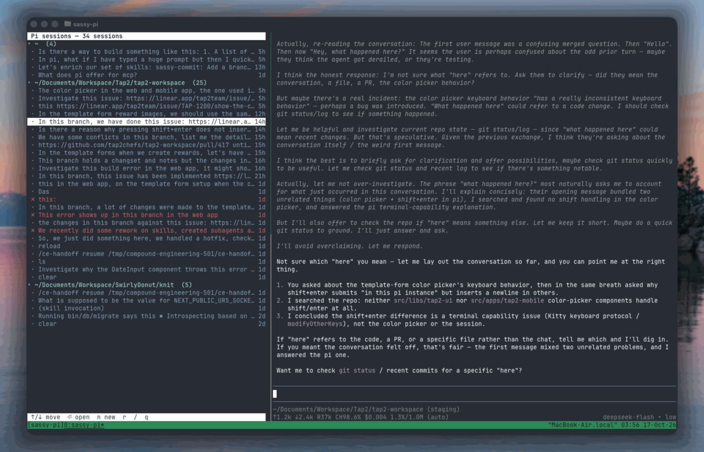

# sassy-pi

A two-pane tmux control panel for Pi sessions.



Session titles are truncated to a single line with an ellipsis; the age is
right-aligned.

## Requirements

| Tool | Why it is needed | Install |
|---|---|---|
| [tmux](https://github.com/tmux/tmux/wiki/Installing) | creates the two panes and resumes sessions | `brew install tmux` / `sudo apt install tmux` / [other platforms](https://github.com/tmux/tmux/wiki/Installing) |
| [Python 3](https://www.python.org/downloads/) | runs `panel.py` (standard library only) | `brew install python` / `sudo apt install python3` / [python.org](https://www.python.org/downloads/) |
| [Pi](https://pi.dev) | the sessions this panel manages | `curl -fsSL https://pi.dev/install.sh \| sh` |
| bash | runs the `main` launcher | preinstalled on macOS and most Linux distributions |

Runs on macOS and Linux (including WSL). The panel renders with Python's
standard-library `curses`, so no extra Python packages are required.

## Quick start

Clone the repo and run the launcher:

```bash
git clone https://github.com/sassywares/sassy-pi.git
cd sassy-pi
./main
```

If the file is not executable, either `chmod +x main` or run it as `bash main`.

- Run outside tmux: creates a `sassy-pi` session with the two panes.
- Run inside tmux: splits the current window and adds the panel to the left.
- `SASSY_PI_WIDTH=25% ./main` overrides the left pane width (default `22%`).

## Optional: add an alias

Run `sassy-pi` from anywhere by adding an alias to your shell config. Run this
from inside the cloned repo so `$PWD` resolves to it.

zsh (`~/.zshrc`):

```sh
echo "alias sassy-pi='$PWD/main'" >> ~/.zshrc && source ~/.zshrc
```

bash (`~/.bashrc`, or `~/.bash_profile` on macOS):

```sh
echo "alias sassy-pi='$PWD/main'" >> ~/.bashrc && source ~/.bashrc
```

Then just run `sassy-pi`. If you prefer a command over an alias, symlink it onto
your `PATH` instead:

```sh
ln -s "$PWD/main" ~/.local/bin/sassy-pi
```

Keys in the left pane: `↑/↓` or `j/k` move, `g/G` jump, `Enter` resumes a
session (and focuses the right pane) or collapses/expands a directory, `←/→`
or `h/l` collapse/expand a directory, `n` new session in the selected project,
`r` refresh, `/` filter (which auto-expands groups), `q` quit. Switch back to
the panel with your tmux prefix + arrow.

## How it works

`main` (bash) creates the layout and passes the right pane's tmux pane id
to `panel.py`. `panel.py` (Python, stdlib only) reads Pi's session store,
renders the list with `curses`, and on Enter runs:

```bash
tmux respawn-pane -k -t <right-pane> -c <session-cwd> "pi --session <id>; exec $SHELL"
tmux select-pane -t <right-pane>
```

## Data source

Sessions live under `~/.pi/agent/sessions/--<encoded-cwd>--/<ts>_<id>.jsonl`.
Each file is JSONL:

- first line: `{"type":"session", "id", "cwd", "timestamp", ...}`
- `{"type":"session_info", "name"}` — set by `/name`
- `{"type":"message", "message": {"role", "content", "stopReason", ...}}`

Status is inferred from the last message:

| status | rule |
|---|---|
| running | a live `pi --session <id>` process is in the process table |
| error | last entry is a failed `toolResult` or assistant `error`/`aborted` |
| active | user spoke last, or modified within 5 minutes |
| idle | otherwise |

## Files

- `main` — tmux launcher / layout.
- `panel.py` — the curses control panel (`--list` prints a plain-text dump).
- `AGENTS.md` — repository guide for agents and contributors.
- `CONCEPTS.md` — vocabulary used in this project.
- `docs/solutions/` — durable learnings from building this.
- `assets/` — screenshots used in this README.
